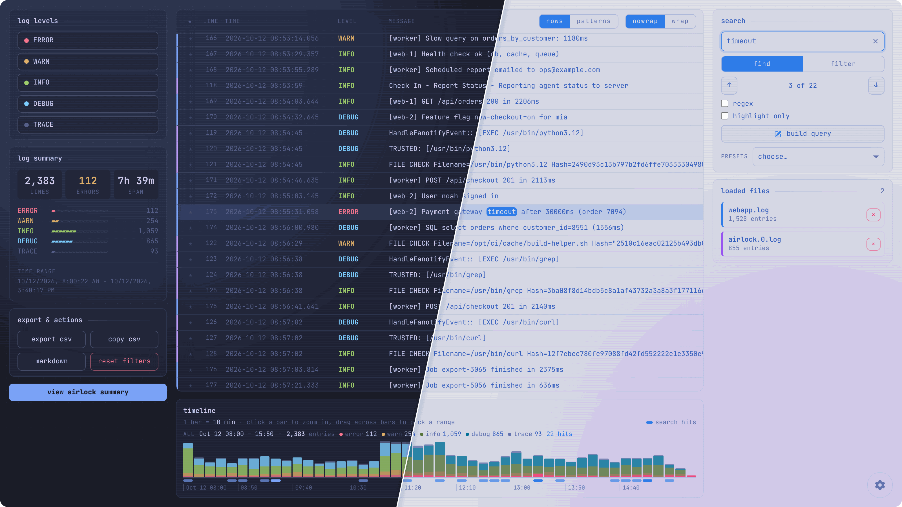
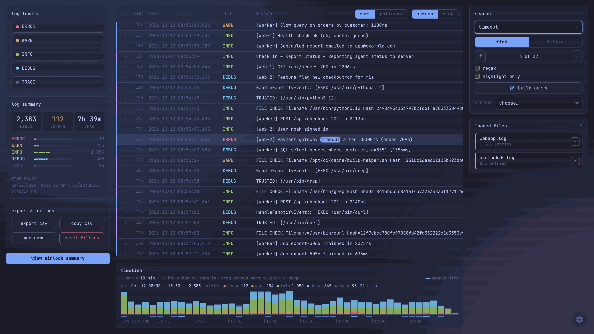
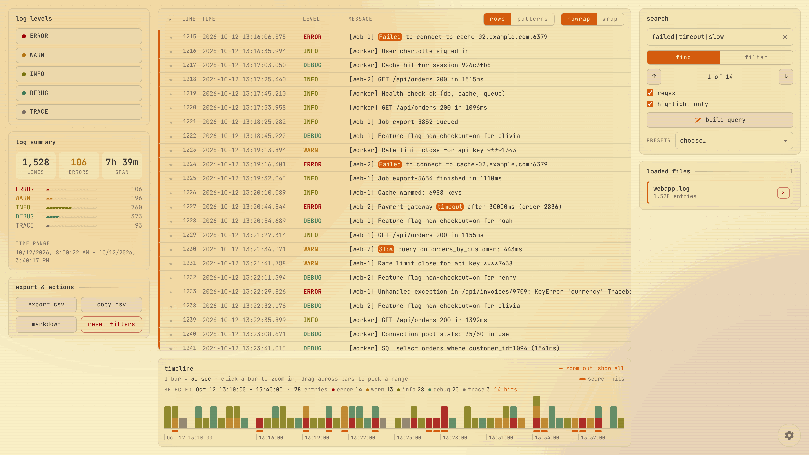
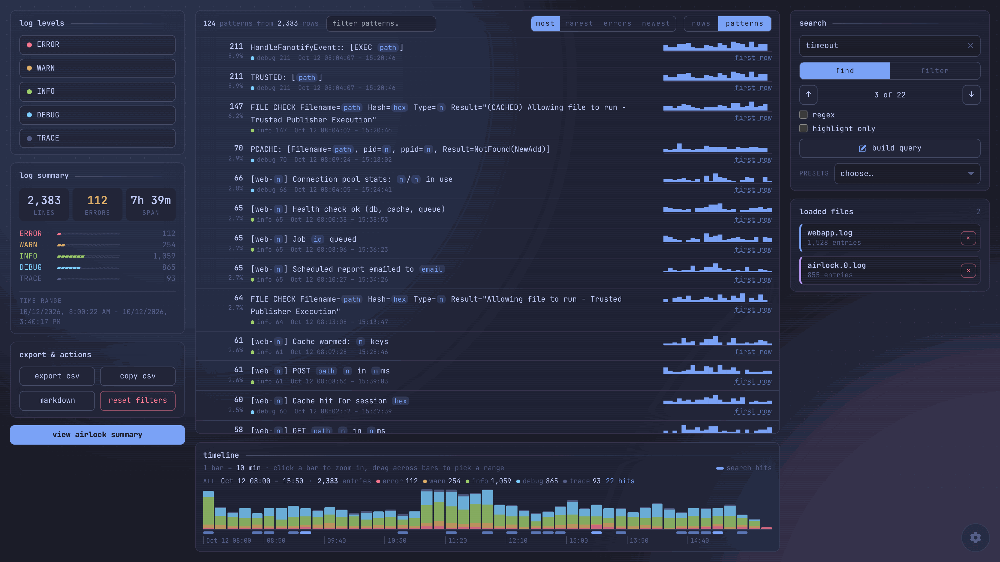
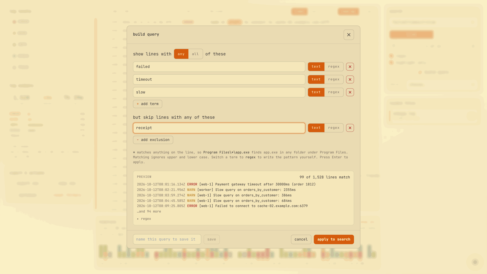
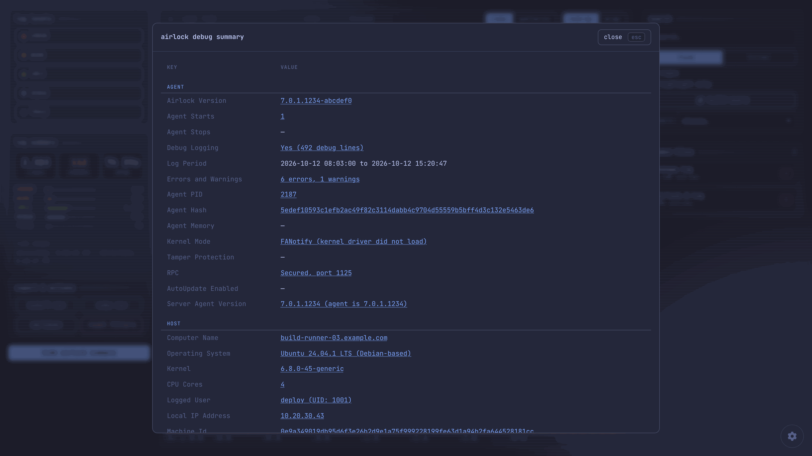
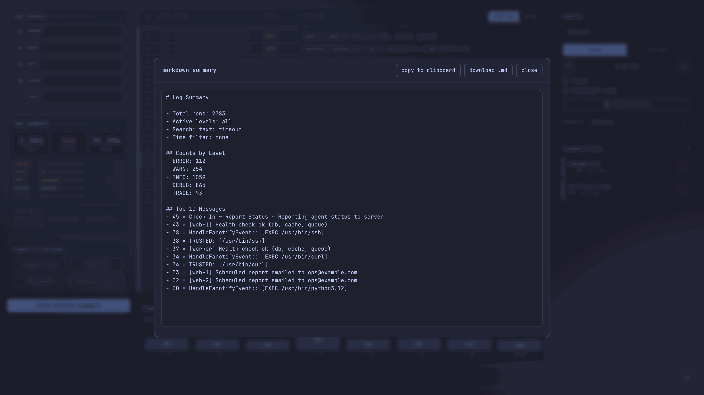
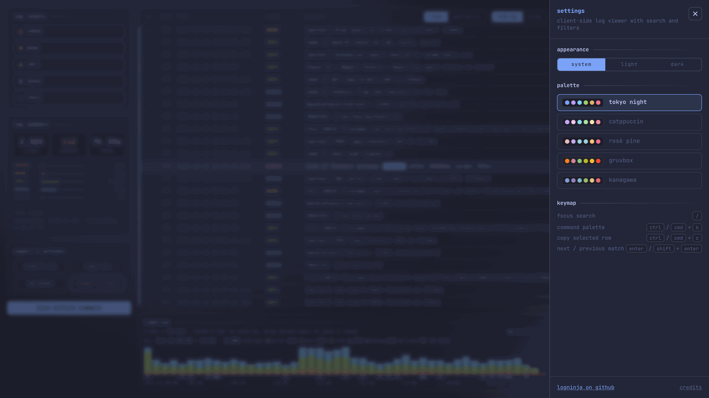

# LogNinja

A fast, client‑side log viewer built with Vite + React + TypeScript. Drag and drop logs, filter by level/text/regex, group similar lines into patterns, browse a timeline, and export results. Designed to work entirely in the browser (no uploads).  

## Features

### UI & Layout
- **Three-column layout**: Controls on left, log viewer center, search/files on right
- **Clean initial state**: When no files are loaded, only the LogNinja logo and file browser are shown - all other UI elements appear after loading
- **Loading overlay**: a blurred overlay with the logo and a waiting kaomoji while files load, which switches to "ready" when they're done
- **Global drag & drop**: Drop log files anywhere on the window, rotated ones like `server.log.1` included (UTF‑8/UTF‑16 aware; archives and other binary files are skipped with a note)
- **Modal interactions**: settings, the Airlock summary, the query builder, the Markdown export, the command palette and what's new all close with Esc or a click outside
- **What's new**: a short popup lists new features once per release (remembered in your browser only, nothing is sent anywhere); reopen it from settings or the command palette

### Log Viewing
- **High-performance virtual scrolling**: Handles very large logs smoothly (up to a million lines per file, several million across files)
  - True infinite scrolling (no pagination)
  - Dynamic line wrapping with auto-height rows
  - **Wrap toggle**: Switch between single-line (horizontal scroll) and multi-line (auto-wrap) views
- **Multi-file support**: Load multiple log files with color-coded file indicators
- Basic log summary view on upload
- Row selection + Ctrl/Cmd+C to copy the full raw line
  - Selected rows persist across filter changes (auto-scrolls to keep selected row visible)

### Search & Filtering
- **Search**: plain text or regex, with match highlighting
  - **Find** mode (the default) keeps every row and jumps between matches with Enter / Shift+Enter or the arrow buttons
  - **Filter** mode hides rows that don't match; **highlight only** shows everything and just marks the matches
  - Clear button to quickly reset search
  - **Search within results**: "search within these" (Ctrl/Cmd+Enter) keeps only the rows matching the current search and empties the box for the next one; "hide these" (Ctrl/Cmd+Shift+Enter) drops them instead. Steps stack as a trail above the search box with the rows left after each; click a step to go back to it, or × to remove just that one. Find, filter, bookmarks, patterns, the timeline and exports all work within the narrowed rows
  - Built-in presets (PowerShell suspicious, Windows crash keywords, Airlock Digital terms)
  - **Query builder** ("build query"): list the words a line should have (any or all of them) and the ones it shouldn't, with `*` as a wildcard (`Program Files\*\app.exe`) or a regex per term, and a live preview of matching lines
  - **Saved queries**: name a query in the builder to keep it (stored in your browser); it shows up under the presets, and "edit query" reopens it in the builder
- **File filtering** (multi-file support):
  - Click a file → filter to show only that file's entries
  - Ctrl+Click files → multi-select mode (toggle multiple files on/off)
  - Click selected file again → deselect it (shows all files)
  - Visual feedback: selected files at full opacity, unselected dimmed
- **Level filtering**: ERROR, WARN, INFO, DEBUG, TRACE, UNKNOWN
  - Only shows the levels present in the loaded files (or the selected files)
  - Click a level → toggle it on or off (pick as many as you like; none picked shows every level)
  - Ctrl/Cmd+Click a level → show only that level (again to clear)
  - Visual feedback: selected levels highlighted, unselected dimmed
- **Time range filtering** by clicking or dragging on the timeline
- **Reset button**: Clears all filters (search, files, levels, time range) at once

### Log Patterns
- **Patterns view** (the "rows / patterns" switch above the table, or "Show Log Patterns" in the command palette): lines that differ only in their variable parts collapse into one pattern, e.g. `request completed in <n>ms`
  - Numbers, IPs, UUIDs, hashes, timestamps, emails, URLs, file paths and session-style ids are blanked out; everything else (like `Result=Blocked` vs `Result=Allowed`) keeps patterns apart
  - Each pattern shows its count and share of rows, level mix, first and last seen, and a sparkline of when it shows up
  - Sort by most common, **rarest** (the odd lines out), most errors, or newest (patterns that first appeared latest)
  - Click a pattern to filter the table to its rows (via a regex in the search box); "first row" jumps to its first occurrence
  - Works on whatever the other filters leave, so drag a range on the timeline to see what was happening in a burst
  - Stack traces group by their first line; big files are grouped in slices so the page stays responsive

### Timeline & Navigation
- **Stacked timeline**: each bar is split by level (errors and warnings on the baseline), so bursts of errors stand out at a glance
  - Bar width adapts to what you're looking at (1 sec up to days), always lined up with your local clock
  - Hover a bar to see its time span, entry count and per-level counts
  - **Click a bar** to zoom into it, or **drag across bars** to zoom into a custom range; both filter the log view
  - "← zoom out" steps back one zoom, "show all" goes back to the full span
  - Follows your file, level and search filters; in find mode, search hits get their own strip under the bars
  - Keyboard: focus the timeline, then arrow keys move between bars, Enter zooms in, Backspace zooms out
  - A readout above the bars shows the range you're looking at (or hovering), its entry count, per-level counts and search hits
  - Long spans (a year or more) bin by whole days, so big files stay quick

### Bookmarks & Export
- Bookmarks: star lines and export them (CSV/Markdown includes "Bookmarked Lines")
  - **Bookmark-only view**: Show only bookmarked lines with configurable context (±1, 3, 5, or 10 lines), within the current level, file and time filters
- Export to CSV or Markdown
- Copy all filtered entries to the clipboard as CSV (very large exports are download-only)

### Special Features
- **Airlock summary**: Auto-detected for Airlock Digital logs (modal with 71 fields grouped into Agent, Host, Server connection, Policy and Executions; Windows, Linux and macOS agents, including 7.x debug logs from all three). Click a value to search the log for the lines behind it

## Screenshots
Two logs loaded together, with find mode jumping between search hits, the log summary and the stacked timeline with search hits marked under it:

Highlight-only regex search after dragging across the timeline to pick half an hour (gruvbox, light):

The patterns view, which groups similar lines and shows when each one happened:

The query builder, with any-of terms, an exclusion and a live preview:

Airlock Digital agent summary, opened automatically for Airlock debug logs:

Markdown summary export:

Settings with system / light / dark modes and five colour palettes:

## Supported Formats (non-exhaustive)

LogNinja reads timestamps and levels from most common log layouts, including:

- ISO 8601 / RFC 3339, plus `YYYY-MM-DD` and `YYYY/MM/DD` date-time variants
- DMY/MDY dates (`dd/MM/yyyy HH:mm:ss`, AM/PM inferred) and `dd Mon yyyy HH:mm:ss`
- Apache/Nginx combined, Redis, Resque, Ruby logger, MongoDB JSON
- MSI installer logs, Phusion Passenger, and `date` output
- Airlock Digital v7.x agent and server log types (Windows, Linux, macOS)

Lines with no timestamp before the first timestamped line are kept as rows without a time.

## Getting Started

**Docker (recommended)**
- Run the published image: `docker run --rm -p 8080:80 ghcr.io/abra5umente/logninja:main`
- Open http://localhost:8080

CI publishes the image after the checks pass on every push to `main`: `:main` follows the branch and `:sha-<commit>` pins one build. To build it yourself instead, clone the repo, then `docker build -t logninja .` and `docker run --rm -p 8080:80 logninja`.

**Local Install**
- Requirements: Node.js 18+ and npm (CI and the Docker build use Node 24)
- Install: `npm install`
- Dev: `npm run dev` (binds `0.0.0.0`), then visit `http://localhost:5173`, or `http://<your-ip>:5173` from other devices on your network
- Test: `npm test`
- Build: `npm run build` (output in `dist/`), then `npm run preview` to serve it

## Keyboard & Tips
- `/` focuses search, `Ctrl/Cmd+K` opens command palette
- In find mode, `Enter` / `Shift+Enter` jump to the next / previous match
- Click a row, then `Ctrl/Cmd+C` to copy its full raw text
- **Wrap toggle**: Enable for multi-line rows that adapt to content length; disable for single-line rows with horizontal scrolling
- **Timeline zoom**: Click a bar to zoom in, or drag across bars to pick a range
- **Multi-select filtering**:
  - `Ctrl/Cmd+Click` on files to select multiple files simultaneously
  - Click log levels to toggle them on and off; `Ctrl/Cmd+Click` shows only that level
  - Click selected item again to deselect it
- **Global drag & drop**: Drop log files anywhere on the page, not just the browse button
- `Esc` or a click outside closes settings, the Airlock summary and other pop-ups
- Virtual scrolling works smoothly in both wrap and no-wrap modes for optimal performance
- Try and find the pizza-flavoured easter egg

## Privacy

The app runs fully in your browser; logs are not uploaded. Exports are generated locally. The only things kept are your theme, saved queries and which "what's new" notes you've seen, all in your browser's local storage. The page loads its font from Google Fonts; offline it falls back to your system's monospace font.
